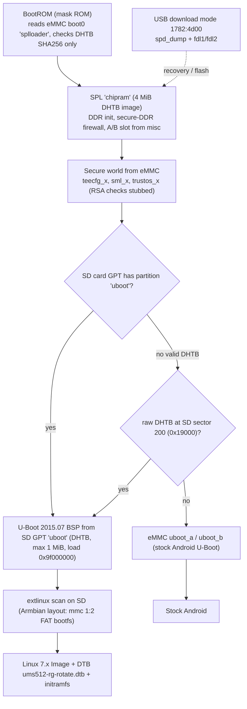

# Phase 1 research 01: boot chain and kernel (Anbernic RG Rotate, UMS512/T618)

Access date: 2026-10-31. Method: GitHub REST API via `gh` (metadata, trees, file contents) and one treeless `git clone --bare` of `thwonp/linux-mainline-sprd` (branch `rotate-fixes`) for commit lists. No hardware touched, nothing flashed, `spd_dump` not run. Scratch copies live in `~/.hermes/profiles/research/cache/scratch/r1/` (not durable).

Source kinds: **P** = primary (upstream repo file/metadata), **S** = secondary (PR text, README prose by the same authors). "UNVERIFIED" = not confirmed from a source or by running something.

## 1. Per-repo summary

License = GitHub-detected SPDX where present; "none" means GitHub detected no license file.

| Repo | Default branch | Last push (API `pushed_at`) | License | Role |
|---|---|---|---|---|
| [beebono/rg-rotate-linux](https://github.com/beebono/rg-rotate-linux) | `main` | 2026-08-12 | none detected | Superproject, bring-up status, build/flash recipes (P) |
| [thwonp/linux-mainline-sprd](https://github.com/thwonp/linux-mainline-sprd) | `ums9230` (target branch is `rotate-fixes`) | 2026-10-26 | NOASSERTION (kernel tree; root `Makefile` carries `SPDX GPL-2.0`) | Kernel fork, fork of crackerjacques fork (P) |
| [beebono/linux-mainline-sprd](https://github.com/beebono/linux-mainline-sprd) | `ums9230` (`rg-rotate`, `emmc-cfw`) | 2026-10-26 | NOASSERTION (GPL-2.0 kernel) | Original RG Rotate kernel (P) |
| [beebono/u-boot-ums512](https://github.com/beebono/u-boot-ums512) | `main` | 2026-08-11 | none detected (has `Licenses/` dir, U-Boot 2015.07 BSP; exact SPDX UNVERIFIED) | Vendor BSP U-Boot, `ums512_rg_rotate_defconfig` (P) |
| [crackerjacques/u-boot-ums512](https://github.com/crackerjacques/u-boot-ums512) | `main` | 2026-08-11 | none detected | Mirror of the above; Armbian pins this, same tip `d1f91089bc` (P) |
| [crackerjacques/ums512_spl](https://github.com/crackerjacques/ums512_spl) | `rotate` (also `armbian`) | 2026-09-23 | none detected; Armbian PR says GPL-2.0-or-later (U-Boot `nand_spl` derived) (S) | SPL / chipram loader with SD boot (P) |
| [beebono/ums512_spl](https://github.com/beebono/ums512_spl) | `rotate` (also `emmc-cfw`) | 2026-10-26 | none detected | Upstream of the crackerjacques fork; MIROKI uses `emmc-cfw` (P) |
| [armbian/build](https://github.com/armbian/build) | `main` | 2026-10-30 | GPL-2.0 | Contains the merged board (P) |
| [beebono/MIROKI](https://github.com/beebono/MIROKI) | `main` | 2026-10-27 | none detected | Standalone eMMC CFW, RetroArch + `ramen` menu (P) |

Last-commit detail:
- `beebono/rg-rotate-linux` main = `94d2d273c2` (2026-08-12). [commit API](https://api.github.com/repos/beebono/rg-rotate-linux/commits/main)
- `thwonp/linux-mainline-sprd` `rotate-fixes` = `fedeb60b65055aacc35f4231692f808748c5de31` (2026-10-26, "bq2415x: boost off at shutdown...").
- `crackerjacques/ums512_spl` `rotate` = `ed5b882070` (2026-08-05, merge of beebono PR #6); `armbian` = `3c5f3547ff` (2026-09-23). [branches](https://github.com/crackerjacques/ums512_spl/branches)
- `beebono/u-boot-ums512` main = `d1f91089bc` (2026-08-11).
- `beebono/MIROKI` main = `ff83b88c51` (2026-10-27).
- Armbian PR [#10813](https://github.com/armbian/build/pull/10813): state MERGED 2026-10-12, created 2026-09-25 by crackerjacques, review APPROVED, 6 commits, +3215/-0, merge commit `6085c92674bd`. Everything below about the PR was read at that merge commit, not at current `main`.

## 2. Boot chain



Sources: SPL flow in [emmc_boot.c](https://github.com/crackerjacques/ums512_spl/blob/rotate/chipram/nand_spl/emmc_boot.c) (lines ~640-870, P); chain summary in [PR #10813 body](https://github.com/armbian/build/pull/10813) (S).

## 3. SPL: how it finds `uboot`, fallbacks, flash

Read from `chipram/nand_spl/emmc_boot.c` on branch `rotate` (P), not just the README:
- `SD_Init()` first; the SPL checks the SD card's GPT with `spl_part_exists()` for `uboot`, `uboot_a`, `uboot_b` and for `sml`, `sml_a`, `sml_b` (lines ~765-778).
- U-Boot on SD **and** sml on SD: full boot from SD. U-Boot on SD but **no** sml (our case): "hybrid", secure world (`teecfg`/`sml`/`trustos`) loaded from eMMC, then u-boot from SD partition named exactly `uboot` (falls back to `uboot_<slot>` name) (lines ~756-860).
- If the SD has no usable GPT `uboot`: legacy raw path `spl_load_uboot_from_sd()` reads a DHTB-wrapped u-boot at SD sector `SDCARD_BOOT_SECTOR` = **200** (byte 0x19000), header 512 B, payload from sector 201 (`#define SDCARD_BOOT_SECTOR 200` in [ums512_1h10.h](https://github.com/crackerjacques/ums512_spl/blob/rotate/chipram/include/configs/ums512_1h10.h), and README "SD-card boot"). Note: an in-code comment says "sector 2900"; the define and README say 200. Treat 200 as correct, 2900 as a stale comment (minor discrepancy).
- If both fail: eMMC `uboot_a`/`uboot_b`, slot chosen from `misc` BCB at offset 0x800 (magic 0x42414342), default slot B. So with the card out, stock Android boots (Armbian PR: "with the card out the stock Android still boots", verified on hardware per PR author, S).
- Image checks: SD u-boot is only checked for DHTB magic `0x42544844`; no RSA/cert. Max size `CONFIG_UBOOT_MAX_SIZE` = 0x100000 (1 MiB), load address `0x9f000000` (ums512_1h10.h). SML 0x94000000, TOS 0x94060000, TEECFG 0x94040000 ([README](https://github.com/crackerjacques/ums512_spl/blob/rotate/README.md)).
- BootROM trust: README states the device validates the DHTB payload hash, not the RSA signature ("proven" by an on-device patched SPL carrying a stale signature). This is the authors' observation, not documentation (S). Armbian PR repeats: "Both halves are verified on hardware".
- Variant to build: `open` (SECBOOT on, four RSA image checks stubbed, unsigned, DHTB by python packer). Output `out/open/spl_a_open.img`, 4 MiB: 512 B DHTB header at 0, payload at 0x200, zero padded. (Armbian family config, below.)
- Branch caution: `rotate` README describes `signed`/`signed-open` variants that need vendored `tools/` and signing keys; `armbian` branch drops `tools/` and keys and its `build.sh all` builds only three variants (commit `3c5f3547ff` message). Prefer `armbian` for a clean public build.

### Flash procedure (for Dakoda, not performed)
Source: Armbian [README.flash-bootloader-first.txt](https://github.com/armbian/build/blob/6085c92674bd4f59beffa7b6a936818446eb817f/config/optional/boards/anbernic-rg-rotate/_packages/bsp-cli/boot/README.flash-bootloader-first.txt) (S) and [beebono README "Flash and connect"](https://github.com/beebono/rg-rotate-linux/blob/main/README.md) (S). The SPL goes to the eMMC **hardware boot partitions** (`splloader` = boot0, `splloader_bak` = boot1), not to a user-area partition.
- BootROM USB id: `1782:4d00`. `514c:8850` is a different mode and will not work (Armbian README).
- FDL files: `fdl1-dl.bin` loaded at `0x5500`, `fdl2-dl.bin` at `0x9efffe00`. They are vendor-PAC files, not shipped by Armbian. MIROKI commits copies at [tools/fdl1-dl.bin](https://github.com/beebono/MIROKI/tree/main/tools) and `fdl2-dl.bin` (P; redistribution licence UNVERIFIED). Mission doc names GammaOSNext UnisocBypass as another source; not read in this task, UNVERIFIED.
- Armbian's exact sequence: back up both slots (`r splloader 0 0x400000 stock_boot0.bak`, same for `splloader_bak`), write `splloader` first, **cold** power cycle and confirm boot, then write `splloader_bak`. From a running Linux/Android instead: `dd` to `/dev/mmcblkNboot0` after `echo 0 > /sys/block/mmcblkNboot0/force_ro`.
- DISCREPANCY on entering download mode: Armbian README says hold the small tact switch on the mainboard, **not** Home; beebono README says hold the Home/Back combo button while plugging USB. Needs one physical confirmation by Dakoda. UNVERIFIED which is right for this unit.
- Pre-flash integrity check Armbian provides: `d[0:4]==b"DHTB"`, length 4 MiB, SHA256 of `d[0x200:0x200+size]` equals header bytes 8..0x28, `size` at 0x30. Run this on the built image on the host before anyone flashes (safe, host-only).
- Recovery claim: BootROM is mask ROM, so a bad SPL is recoverable over USB (Armbian README, S; consistent with beebono README "Recovery"). Do not rely on boot0→boot1 fallback.

## 4. U-Boot

- Source: `https://github.com/beebono/u-boot-ums512` branch `main`, mirrored as `crackerjacques/u-boot-ums512`. Armbian pins mirror commit **`d1f91089bcb2df300f1e8a92938c1ca84a183e8c`** (identical to beebono tip, API-verified). Defconfig `ums512_rg_rotate_defconfig`; board header `include/configs/ums512_rg_rotate.h`; DTS `arch/arm/dts/ums512_rg_rotate.dts`. Generic `ums512_1h10_defconfig` is **not** enough: only the rg_rotate header defines `CONFIG_FS_FAT`, otherwise extlinux halts "No OS found" (comment in [anbernic-rg-rotate.csc](https://github.com/armbian/build/blob/6085c92674bd4f59beffa7b6a936818446eb817f/config/boards/anbernic-rg-rotate.csc), P).
- Build needs `ARCH=arm` on every make pass and 5 Armbian patches (`patch/u-boot/u-boot-ums512/0001..0005`: drop `-ansi`, `fdt_for_each_subnode` arg order, GCC 14 diagnostics as warnings, drop `cp_boot.h` include, robust `checkarmreloc`). Target: `u-boot-dtb.bin`, wrapped to `uboot_dhtb.img` by a python DHTB wrap in `sprd-ums512.conf` (P).
- `rg-rotate-linux` submodule pins `src/u-boot` at `34afab15d051` (2026-07-24, "better charge handling"), older than `d1f91089bc` (rg-cube/extlinux work, 2026-08-11) ([tree API](https://api.github.com/repos/beebono/rg-rotate-linux/git/trees/main?recursive=1)).
- extlinux behaviour differs by tree:
  - beebono dev flow: scan `mmc 1:1` (SD p1 boot, rootfs p2 `/dev/mmcblk0p2`) before eMMC `boot_a`/`boot_b` ([README](https://github.com/beebono/rg-rotate-linux/blob/main/README.md)).
  - Armbian: "extlinux scan, hardcoded to `mmc 1:2`", so the FAT boot partition must be GPT partition 2 (PR body, S). **Rotate OS should follow the Armbian layout** (below) since SPL needs a GPT partition named `uboot` anyway.
- Bootloader features available (beebono bring-up, P): panel + boot logo, charge-while-off display, trampoline to stock U-Boot ([DEVICE-BRINGUP.md](https://github.com/beebono/rg-rotate-linux/blob/main/DEVICE-BRINGUP.md) "U-Boot 2nd-pass targets").

## 5. SD card layout the SPL + U-Boot expect

From Armbian `create_partition_table()` in [sprd-ums512.conf](https://github.com/armbian/build/blob/6085c92674bd4f59beffa7b6a936818446eb817f/config/sources/families/sprd-ums512.conf) (P), `UBOOT_PART_MB=16`, `UBOOT_PART_START_MB=1`:

| # | GPT name | Start | Size | Type GUID | Content |
|---|---|---|---|---|---|
| table | GPT | LBA 0..33 | | | SPL needs a valid GPT on the card; backup GPT read is skipped on cards of unknown size (SPL commit `52ded93ee2`) |
| 1 | `uboot` (exact, lower case) | 1 MiB | 16 MiB | `8DA63339-0007-60C0-C436-083AC8230908` | raw `uboot_dhtb.img` (512 B DHTB header + u-boot payload) at partition start via `dd seek=1M`; payload must be < 1 MiB (SPL limit) |
| 2 | `bootfs` | 17 MiB | `BOOTSIZE` | `BC13C2FF-59E6-4262-A352-B275FD6F7172` | FAT: `extlinux/extlinux.conf`, `Image`, `sprd/ums512-rg-rotate.dtb`, initrd |
| 3 | rootfs | after p2 | rest | Linux filesystem | ext4 root (Armbian default; ours would be Arch ARM rootfs) |

- Raw-sector fallback (no GPT `uboot`): DHTB u-boot at SD sector 200 = byte offset 0x19000; this overlaps partition space and is irrelevant if the `uboot` partition exists. Do not mix.
- Size ceilings: SPL image 4 MiB (per boot slot); u-boot 1 MiB (SPL), 16 MiB slot (Armbian) ([write_uboot_platform in sprd-ums512.conf](https://github.com/armbian/build/blob/6085c92674bd4f59beffa7b6a936818446eb817f/config/sources/families/sprd-ums512.conf)).
- Must keep: stock eMMC partitions `teecfg_*`, `sml_*`, `trustos_*`, `misc`, `uboot_*`, plus `wcnmodem` and `l_agdsp` for firmware extraction (Armbian flash README). Do not repartition eMMC.
- Armbian cmdline: `console=tty0 loglevel=1 log_buf_len=8M`; no UART on board, USB CDC-ACM `ttyGS0` is the only serial console ([csc](https://github.com/armbian/build/blob/6085c92674bd4f59beffa7b6a936818446eb817f/config/boards/anbernic-rg-rotate.csc)).

## 6. Kernel: recommended source

- Rotate OS target: **`thwonp/linux-mainline-sprd` branch `rotate-fixes` @ `fedeb60b65055aacc35f4231692f808748c5de31`** (2026-10-26). Kernel version in root Makefile: **7.2.9** (`VERSION=7 PATCHLEVEL=2 SUBLEVEL=9`). Verified by reading `Makefile` at that ref.
- Lineage: Otto Pflüger `ums9230-mainline` (codeberg) → beebono `rg-rotate` (7.1-rc1, `464b3e7bf4`, 2026-08-12) → rebased onto 7.2 as `rotate-fixes`. Author counts from `git log` on the branch tip range: ~113 Noxwell (= beebono's commits rebased, e.g. `c15c443b35` = rebased "reserve all stock carveouts"), 109 Otto Pflüger, 34 thwonp, 17 crackerjacques, 6 jackheinlein. `rg-rotate` is not an ancestor (225 commits not in `rotate-fixes`, 26306 commits in `rotate-fixes` not in `rg-rotate`, mostly the 7.1→7.2 base change). GitHub compare API times out, so no automated per-file diff.
- Armbian's pin: `crackerjacques/linux-mainline-sprd` commit `d0aba8189b5a480c1c4f934b2a75b0664cf51f8a` (2026-10-07), which is an ancestor-line commit inside `rotate-fixes` (appears in its log), plus Armbian patch set `sprd-ums512-7.2`. thwonp's `rotate-fixes` adds ~25 commits after it (2026-10-17..26).
- What `rotate-fixes` adds over Armbian's pin (thwonp commits, [log](https://github.com/thwonp/linux-mainline-sprd/commits/rotate-fixes)): mostly suspend/resume and power: `pmdomain: sprd: power domains off the way the vendor driver does`, `iommu: sprd: restore the attached domain on resume`, `drm/sprd: gate the DPU clocks while the CRTC is off`, `arm64: dts: sprd: ums512: enable pm_sys and the AON timers`, `the arch timer stops in suspend`, AGDSP/aw87390/MICBIAS/WCN/musb/bltc LED suspend fixes, `wifi: sc23xx: power the chip's Wi-Fi side off while no interface is up`, `bq2415x: boost off at shutdown...`, `bq2415x: charge again when the OTG VBUS regulator is disabled`, `sc27xx fuel gauge: trust the boot OCV over a stale saved capacity`, `musb: sprd_dma: abort a busy channel instead of BUG()`, `tcpm sc27xx: restart toggling`, boot logo from `boot-logo.ppm`. Branch ships Armbian patch dir commit `e60e416e9a` ("Armbian patch/kernel/archive/sprd-ums512-7.2 (trunk.95)").
- Files: defconfig [`arch/arm64/configs/ums512_defconfig`](https://github.com/thwonp/linux-mainline-sprd/blob/rotate-fixes/arch/arm64/configs/ums512_defconfig) (839 lines, `CONFIG_LOCALVERSION="-sprd-ums512"`); DTS in `arch/arm64/boot/dts/sprd/`: **`ums512-rg-rotate.dts`** (model "Anbernic RG Rotate", compatible `sprd,ums512-1h10`, `sprd,ums512`), `ums512-1h10.dts` (generic board), `ums512.dtsi` (SoC); Makefile builds both `ums512-1h10.dtb` and `ums512-rg-rotate.dtb`. Defconfig is byte-for-byte unchanged vs beebono `rg-rotate` per `git diff` (only the two DTS files differ: +59/-32 lines).
- Branch topology caveat: `thwonp/linux-mainline-sprd` default branch is `ums9230`; clone with `-b rotate-fixes`. It is a fork, so history is huge (treeless bare clone took ~2m45s).
- Why not beebono `rg-rotate`: it keeps `pmsys` rproc disabled ("CM4 stays behind stock lock", commit `9d13425e36`), which is what thwonp reversed to get suspend and sensor hub working. Why not `emmc-cfw`: MIROKI-specific, no SPL/u-boot dual-boot (section 9).
- DEVICE-BRINGUP claims kernel 7.1 verified on device; no source says 7.2.9 + `rotate-fixes` was boot-tested by Dakoda or the authors beyond thwonp's own commit messages. UNVERIFIED on our image.

## 7. Subsystem status matrix

Evidence = [DEVICE-BRINGUP.md](https://github.com/beebono/rg-rotate-linux/blob/main/DEVICE-BRINGUP.md) (bring-up on 7.1, beebono, last push 2026-08-12) unless noted; later rows add `rotate-fixes` commits and the [Armbian PR](https://github.com/armbian/build/pull/10813) "working on hardware" list. None of this is verified by me on hardware.

- **Display (DSI panel, 720x720)**: working. DRM `DRM_SPRD=y`, `DRM_PANEL_GENERIC_DSI=y`, panel node `rocknix,generic-dsi` with `panel_description`, cold kernel-native init, fbcon + login on panel. `rotate-fixes` adds DPU clock gating and "backlight off through panel init". [DISPLAY-BRINGUP.md](https://github.com/beebono/rg-rotate-linux/blob/main/docs/DISPLAY-BRINGUP.md) exists (not read).
- **Touch**: working. Goodix GT911 on i2c3 0x14, `touchscreen-inverted-x/y`, `CONFIG_TOUCHSCREEN_GOODIX=y`; IRQ wiring added by crackerjacques (`eeb83f0d03`) so it stops polling at 200 ms (Armbian PR). MIROKI also commits "enable the GT911" (2026-10-27).
- **Buttons / gamepad**: working. Stock stick/ADC path is inert (stickless SKU); all inputs are discrete GPIOs via `gpio-keys` with `BTN_*` codes (face, shoulders, Start/Select, D-pad as `BTN_DPAD_*`), `joydev` gives `/dev/input/jsX`; vol keys + power in `sys_keys`. Some pads needed func4 pinmux. Rumble: `sc27xx-vibra` on/off only (separate evdev node; needs InputPlumber or similar to merge, DEVICE-BRINGUP). Armbian ships `rotate-pad2key` for key remap.
- **Audio**: speaker playback working via DSP-mediated VBC path, AW87391 amp over I2C, requires `agdsp.bin` in initramfs and an `asound.state` with `DSP VBC Profile Select = 961216512`. Armbian PR documents a DSP quirk: the first VBC scene start per boot (via PipeWire) is lost, so shipping a "prime" step (`rotate-audio-prime`, 1 s silence) is needed. Internal mic listed as working in the PR. Audio bugs fixed since in `rotate-fixes` (suspend/IIS1). Headphone jack behavior: not stated, UNVERIFIED.
- **Wi-Fi / BT**: working. Marlin3 Lite / SC2355 SDIO. Wi-Fi ~25 Mbit/s up / ~176 Mbit/s down (iperf3, author-measured, DEVICE-BRINGUP); driver `sc23xx_wlan` + `sprdwcn`; BT via `btsprdsdio` (scan+pair verified; A2DP needs PipeWire). Needs `wcnmodem.bin` + INI files; Armbian extracts the blob from the eMMC `wcnmodem` partition on first boot (blobs not redistributable). Do NOT put `wcnmodem.bin` in the initramfs (wedges udev; PR). Wi-Fi power-off when idle: `rotate-fixes` commit `4cc45f9f23`.
- **USB OTG / host**: working, automatic dual-role through sc2730 Type-C PD (`sc27xx_pd`); `dr_mode` must stay `"otg"`. Host VBUS comes from the bq2415x OTG boost, not a discrete regulator (so bus-powered loads are limited). Armbian PR enumerated HID, USB audio, RTL8153, RTL-SDR. musb suspend/DMA fixes on `rotate-fixes`.
- **Charging**: working. AW32257 charger on mainline `bq2415x` (`bq24158-0`), SC2730 fuel gauge. Not done: JEITA per-zone derating; `ti,charge-current` kept at 1240 mA vs stock 2000 mA (about +23 min on a full charge, per bring-up). Charge-while-off screen in U-Boot works. Fixes in `rotate-fixes` (boost-off at shutdown, boot OCV).
- **GPU / Panfrost**: probes and passes a GEM/MMU smoke test: `mali-g52 id 0x7402`, `shader_present=0x3`, `/dev/dri/renderD128`, devfreq OPPs 384-850 MHz. **Shader execution via SUBMIT was untested** (no Mesa installed at that time). Defconfig has `CONFIG_DRM_PANFROST=m`. MIROKI instead builds the vendor `mali_kbase` + `libmali` blob (prebuilts in repo) and has `# CONFIG_DRM_PANFROST is not set` in its config; reason not stated. Treat Mesa Panfrost rendering as UNVERIFIED until a render test runs on device. Needs clk fix in `drivers/clk/sprd/ums512-clk.c` (reset regmap) that is in the tree.
- **Suspend / PM**: deep suspend (`echo mem`) reported working for 5+ min with five blockers fixed (FGU `-19`, WCN `-110`, cpufreq resume WARN, musb wake, `sc27xx_wdt` PM ops) on 7.1. `rotate-fixes` adds ~15 further suspend commits (pm domains, IOMMU, AGDSP, arch timer stops in suspend). A userspace `hw-watchdog.service` must feed `/dev/watchdog0` and `/dev/watchdog1`; they stop on suspend. Hall switch is `wakeup-source` with wake-on-open only. Battery drain figures: Armbian PR measured about 114 mA idle, backlight off, Wi-Fi associated (`rotate-wcn-nosleep` costs ~10 mA); this is the only quoted number (S). Thwonp's `docs/deep-sleep.md` in `base618` was not read in this task (out of the requested scope).
- **CPU / thermal**: cpufreq working (A55 614 MHz-1.82 GHz, A75 1.23-2.002 GHz, schedutil); 12 thermal zones, 70 °C passive, 110 °C critical. DDR devfreq absent: memory clock likely pinned (open item in bring-up). Armbian patch raises a thermal passive trip.
- **Swivel sensor**: **Hall switch on `ap_gpio 54` (SPI2_DI, func4 mux), exposed via `gpio-keys` as `EV_SW` with code `SW_LID`**, active-low, 10 ms debounce, label "Hall Swivel", `wakeup-source` with `wakeup-event-action = EV_ACT_DEASSERTED` (wake on open only). Evidence: DTS lines 317-337 of [ums512-rg-rotate.dts @ rotate-fixes](https://github.com/thwonp/linux-mainline-sprd/blob/rotate-fixes/arch/arm64/boot/dts/sprd/ums512-rg-rotate.dts); `SW_LID` also in beebono's `rg-rotate` DTS. **Discrepancy**: DEVICE-BRINGUP prose says `SW_TABLET_MODE`; the DTS says `SW_LID`. The DTS is the code, trust `SW_LID`. In userspace `systemd-logind` treats `SW_LID` as a laptop lid (would suspend on close) unless `HandleLidSwitch=ignore` or equivalent is set; closing the swivel is how MIROKI sleeps the device. States: DEVICE-BRINGUP says it toggles 1 on swivel-to-close, 0 on open.
- **Accelerometer / gyro**: bring-up says the stock DT declares Hall only. Newer evidence contradicts: defconfig enables `IIO_SPRD_SHUB` + `_ACCEL/_GYRO/_LIGHT/_MAGN/_COMPASS/_PROXIMITY`; MIROKI main ships `shub_fw_accelerometer_icm42607`/`_sc7u22` and `shub_fw_gyroscope_*` firmware and has recent commits "sensorhub: accelerometer and gyro through the pm_sys CM4" and "ramen: touch and motion" (2026-10-27), plus thwonp `arm64: dts: sprd: rg-rotate: no sensor hub client on pm_sys's channel 4`. So an IMU may exist behind the CM4 sensor hub; whether it is readable under mainline `rotate-fixes` is UNVERIFIED.
- **LEDs / RTC / vibration**: working (status LEDs, `rtc-sc27xx`, rumble).
- **SD card**: working at UHS-I SDR104, `broken-cd` (poll-based detect, no CD GPIO). **UART**: none broken out; console is USB CDC-ACM.

## 8. Kernel config fragments for Rotate OS

Based on the `rotate-fixes` defconfig (verified by grep). Present already vs to add:

```
# Present in ums512_defconfig (keep)
CONFIG_ANDROID_BINDER_IPC=y
CONFIG_ANDROID_BINDER_DEVICES="binder,hwbinder,vndbinder,puddlejumper,hwpuddlejumper,vndpuddlejumper"
CONFIG_PSI=y  CONFIG_USER_NS=y  CONFIG_SYSVIPC=y  CONFIG_CGROUP_*=y  CONFIG_VETH=y  CONFIG_BRIDGE=y
CONFIG_NF_TABLES=y  CONFIG_IP_NF_IPTABLES=y  CONFIG_ZRAM=y  CONFIG_ZRAM_DEF_COMP_ZSTD=y
CONFIG_DMABUF_HEAPS_SYSTEM=y  CONFIG_DMABUF_HEAPS_CMA=y  CONFIG_DMA_CMA=y  CONFIG_CMA_SIZE_MBYTES=32
CONFIG_ARCH_SPRD=y  CONFIG_ARM_SPRD_HW_CPUFREQ_NORMAL=y  CONFIG_ARM_SPRD_TOP_DVFS=y  CONFIG_SPRD_THERMAL=y
CONFIG_DRM=y  CONFIG_DRM_SPRD=y  CONFIG_DRM_PANEL_GENERIC_DSI=y  CONFIG_DRM_MALI_DISPLAY=y  CONFIG_DRM_PANFROST=m
CONFIG_TOUCHSCREEN_GOODIX=y  CONFIG_INPUT_EVDEV=y  CONFIG_INPUT_JOYDEV=y  CONFIG_INPUT_SC27XX_VIBRA=y
CONFIG_CHARGER_BQ2415X=y  CONFIG_FUEL_GAUGE_SC27XX=y  CONFIG_TYPEC_SC27XX_PD=y  CONFIG_USB_MUSB_SPRD=y  CONFIG_PHY_SPRD_USB2=y
CONFIG_SND_SOC_SPRD=y  CONFIG_SND_SOC_UNISOC_VBC_V4_SC2730=y  CONFIG_UNISOC_WCN_BSP=y  CONFIG_BT_SPRDSDIO=y
CONFIG_SPRD_PMSYS_REMOTEPROC=y  CONFIG_SPRD_AUDCP_BOOT=y  CONFIG_SPRD_PM_DOMAINS=y  CONFIG_SPRD_IOMMU=y
CONFIG_MMC_SDHCI_SPRD=y  CONFIG_SPRD_DMA=y  CONFIG_SPRD_MBOX=y  CONFIG_RPMSG_SPRD_SIPC=y  CONFIG_PWM_SPRD=y

# MISSING from the defconfig, needed for binderfs (Waydroid, priority 4)
CONFIG_ANDROID_BINDERFS=y      # Kconfig: depends on ANDROID_BINDER_IPC, default n; absent from defconfig (grep)
# Because binderfs allocates devices dynamically, Waydroid can drop the static "puddlejumper" names; keeping them is harmless.

# Decision points
CONFIG_DRM_PANFROST=y          # recommended for a no-initramfs-module KMS path; bring-up built it in (=y). Defconfig has =m. Needs a render test before trusting.
```

Sources: [defconfig](https://github.com/thwonp/linux-mainline-sprd/blob/rotate-fixes/arch/arm64/configs/ums512_defconfig) lines 17, 32, 120, 305-308, 509-519, 584, 614, 744-745; [drivers/android/Kconfig](https://github.com/thwonp/linux-mainline-sprd/blob/rotate-fixes/drivers/android/Kconfig) for `ANDROID_BINDERFS`.
- Items for Waydroid that I could not source: need for `memfd`/ashmem replacement, `CONFIG_SYNC_FILE`, `CONFIG_ANDROID_BINDER_IPC_RUST` conflict (it `depends on !ANDROID_BINDER_IPC`, so do not enable both). Waydroid's own kernel requirements page was not read: UNVERIFIED.
- Armbian board hook changes on top of the defconfig: force 48-bit VA (defconfig asks for 39-bit), PM debug, TEO cpuidle, HID gadget, external controllers, AES-CE, policy routing, WireGuard, fq_codel (PR body). [config/kernel/linux-sprd-ums512-edge.config](https://github.com/armbian/build/blob/6085c92674bd4f59beffa7b6a936818446eb817f/config/kernel/linux-sprd-ums512-edge.config) is a verbatim copy of `ums512_defconfig` at the time.
- Trim candidates (for the "trimmed for this board" goal; each is a guess to confirm by `lsmod`/boot test, not sourced): `DRM_HDLCD`, `DRM_KOMEDA`, `BT_HCIBTUSB`, Bluetooth `BNEP/HIDP`, `IIO_SPRD_SHUB_*` unused sensors, `NF_TABLES` family if Waydroid dropped, `CGROUP_HUGETLB`, `BSD_PROCESS_ACCT`, `TASKSTATS`. Keep `CONFIG_PREEMPT=y`? Defconfig sets it (line 10); for game latency vs throughput this is a tuning choice not covered by a source.
- Firmware at boot: `agdsp.bin` must be reachable in the initramfs (`sprd-audcp-boot` is built in, probes ~0.45 s); `wcnmodem.bin` must not (Armbian PR). Use `MODULES=dep`-style minimal initramfs.
- Kernel cmdline from Armbian: `console=tty0 loglevel=1 log_buf_len=8M`. beebono: `console=tty0 ignore_loglevel rdinit=/init` for boot.img use.

## 9. Armbian PR #10813 and MIROKI: what they tell us

- Armbian board `anbernic-rg-rotate` (`BOARDFAMILY=sprd-ums512`, `KERNEL_TARGET=edge`, DTB `sprd/ums512-rg-rotate.dtb`, GPT, BOOTFS FAT): [csc](https://github.com/armbian/build/blob/6085c92674bd4f59beffa7b6a936818446eb817f/config/boards/anbernic-rg-rotate.csc). Family pins: kernel `crackerjacques/linux-mainline-sprd` @ `d0aba8189b5a`, u-boot `crackerjacques/u-boot-ums512` @ `d1f91089bc` (config `ums512_rg_rotate_defconfig`), SPL `crackerjacques/ums512_spl` @ `3c5f3547ff7...` (family config uses the 10-char prefix `3c5f3547ff`), no ATF (secure world comes from stock eMMC).
- Image outputs: SD image plus `<image>.spl.img` (4 MiB) to flash once.
- Merged 2026-10-12 with 21 kernel patches (DT: last DRAM page, GT911 IRQ; ASoC; sc23xx Wi-Fi incl. IPv4 notify to firmware, without which broadcasts/ARP are not delivered). The same patches are already folded into `rotate-fixes`, so Rotate OS does not need to re-apply them if it uses `rotate-fixes`; the Armbian patch dir `sprd-ums512-7.2` has two more (musb log, thermal passive trip) that are in the branch per its log (`e60e416e9a`). Whether the thermal patch is applied in `rotate-fixes` source: UNVERIFIED.
- MIROKI (eMMC CFW): different, destructive model. Boot chain "rebuilt SPL + small EL3 monitor (PSCI), then kernel and squashfs root; stock secure world and u-boot not used" ([README](https://github.com/beebono/MIROKI/blob/main/README.md)). eMMC layout in [cfw-emmc-partitions.xml](https://github.com/beebono/MIROKI/blob/main/tools/cfw-emmc-partitions.xml): `prodnv` 10 MB, `miscdata` 1, `uboot_log` 4, `boot` 64 (raw, Image at offset 0, DTB at 48 MiB), `rootfs` 2048 (squashfs), `data` rest (exFAT); SPL in `splloader`/`splloader_bak`. Flash uses `spd_dump ... repartition cfw-emmc-partitions.xml; write_part splloader/boot/rootfs`. README: "INSTALLING MIROKI WILL OBLITERATE ANDROID ... DOES NOT SUPPORT DUAL BOOTING". Not compatible with the Rotate OS requirement of an Android fallback; reference for `ramen` swivel menu, sleep-on-swivel-close, and the sensor hub work only. A possible later option: MIROKI's EL3 monitor path skips SML/TOS/u-boot (faster boot), at the cost of the fallback. Not evaluated.

## 10. Recommended exact sources and commits

| Stage | Source | Ref | Why |
|---|---|---|---|
| SPL | `https://github.com/crackerjacques/ums512_spl.git` | branch `armbian`, commit **`3c5f3547ff42f676e64b70f899ca74c667c7cbbf`** (2026-09-23; full SHA from the Armbian family config) | Hardware-verified in Armbian PR, no signing keys/vendor binaries, `./build.sh open` → `out/open/spl_a_open.img` |
| U-Boot | `https://github.com/crackerjacques/u-boot-ums512.git` (identical to `beebono/u-boot-ums512`) | `main` = **`d1f91089bcb2df300f1e8a92938c1ca84a183e8c`**, `ums512_rg_rotate_defconfig`, apply Armbian's 5 patches | Has `CONFIG_FS_FAT`, extlinux scan, panel/logo; build with `ARCH=arm`, DHTB-wrap |
| Kernel | `https://github.com/thwonp/linux-mainline-sprd.git` | `rotate-fixes` = **`fedeb60b65055aacc35f4231692f808748c5de31`** (7.2.9) | Superset of Armbian pin, adds suspend/power work |
| Kernel fallback | `crackerjacques/linux-mainline-sprd` | **`d0aba8189b5a480c1c4f934b2a75b0664cf51f8a`** | Armbian-pinned, known good on hardware per PR |
| DTB | in kernel tree | `sprd/ums512-rg-rotate.dtb` | |
| Cross-check pin | `beebono/rg-rotate-linux` | `94d2d273c2` (SPL `ed5b882070`, kernel `464b3e7bf4`, u-boot `34afab15d0`) | Older, 7.1 |

Build-script reference: Armbian [sprd-ums512.conf](https://github.com/armbian/build/blob/6085c92674bd4f59beffa7b6a936818446eb817f/config/sources/families/sprd-ums512.conf) is the most complete, reproducible reference for the SPL + U-Boot + partition recipe (DHTB wrap, `dd seek`, sfdisk script). The Rotate OS image build (Phase 2) can reuse it with an Arch rootfs.

## 11. Risks and open questions

1. **Flashing the SPL is the one irreversible-looking step**; recovery needs BootROM USB download mode and the vendor FDL files. Exact steps for Dakoda (not executed):
   - Back up `splloader` and `splloader_bak` with the Armbian `r splloader 0 0x400000 ...` commands; write `splloader` first, cold-boot, then `splloader_bak`.
   - Confirm which physical button enters `1782:4d00` (Armbian: mainboard tact switch; beebono: Home/Back). Conflict not resolved.
2. **FDL licensing/availability**: `fdl1-dl.bin`/`fdl2-dl.bin` are vendor binaries; MIROKI commits them, Armbian says to get them from a PAC. Source rights UNVERIFIED.
3. **Panfrost end-to-end** is not shown working: bring-up only tested open/MMU, MIROKI chose the vendor blob. Plan a render test (`kmscube` / RetroArch GL) before committing to Mesa; fallback is `mali_kbase` + `libmali` ([beebono/mali_kbase](https://github.com/beebono/mali_kbase) branch `ums512`), which would conflict with the "Mesa Panfrost" goal.
4. **Kernel 7.2.9 `rotate-fixes` is a moving, single-author branch** (thwonp) on a fork whose default branch is a different one; pin by SHA, mirror it locally under `upstream/`.
5. **Swivel semantics**: `SW_LID` (DTS) vs `SW_TABLET_MODE` (prose). The frontend must read the actual event on device (`evtest`). logind lid handling must be disabled/redefined.
6. **IMU presence unknown**: Hall-only in stock DT, sensor hub drivers present in kernel and MIROKI. Do not design swivel UX around an accelerometer until verified.
7. **Firmware extraction**: Wi-Fi/BT/audio need `wcnmodem.bin` (≈925 KiB) and `agdsp.bin` (≈5 MiB) from the unit's own eMMC partitions `wcnmodem` and `l_agdsp` (Armbian README). The Android eMMC partitions must stay. Arch ARM rootfs needs its own first-boot extraction service (reuse `rotate-extract-firmware` logic).
8. **initramfs race**: `wcnmodem.bin` in initramfs hangs udev; `agdsp.bin` must be there; audio needs one extra reboot after first extraction regenerates the initramfs (Armbian README). Arch's mkinitcpio equivalent needs the same design.
9. **Audio first-start quirk** (lost VBC scene start) needs the prime step under PipeWire; direct ALSA from RetroArch may or may not hit it. UNVERIFIED.
10. **SD requirements**: partition 1 must be named exactly `uboot`; FAT boot partition must be partition 2 for extlinux (`mmc 1:2`). Cards with unknown size had a hang until SPL commit `52ded93ee2` (2026-07-30), which the `armbian` branch includes (it is later than that commit; verified by dates only).
11. **Battery goals**: only one power number found (≈114 mA idle with backlight off, Wi-Fi associated, Armbian PR). DDR devfreq absent. JEITA derating absent. No measured gaming battery draw anywhere. All UNVERIFIED for target.
12. **Android-fallback guarantee** relies on the unsigned SPL still completing secure-world bring-up from eMMC; stated verified by the PR author, not by us.
13. **Licence clarity**: none of beebono/crackerjacques repos carry a LICENSE file detectable by GitHub; derived GPL-2.0 code (kernel, U-Boot, `nand_spl`) applies, but vendored Unisoc BSP signing keys exist in `ums512_spl` `rotate` branch `tools/` (do not copy; the `armbian` branch drops them).
14. **Not read** (out of this card's scope or time): `thwonp/base618` (deep-sleep.md), `thwonp/plorpOS`, `GammaOSNext/UnisocBypass`, `docs/DISPLAY-BRINGUP.md`, `POWER-BRINGUP-NOTES.md`, Waydroid kernel requirements. Hand-offs: suspend/power detail to a later card on `base618` docs; frontend swivel handling to the frontend lane.

## 12. Reproduce the key facts

- Kernel version: `gh api 'repos/thwonp/linux-mainline-sprd/contents/Makefile?ref=rotate-fixes' --jq .content | base64 -d | head -6`
- Defconfig binder lines: `grep -n BINDER arch/arm64/configs/ums512_defconfig` (shows `ANDROID_BINDER_IPC=y`, no `ANDROID_BINDERFS`)
- Hall node: `grep -n -B2 -A12 'sw-hall' arch/arm64/boot/dts/sprd/ums512-rg-rotate.dts`
- PR state: `gh pr view 10813 -R armbian/build --json state,mergedAt`
- SPL pins: `gh api repos/beebono/rg-rotate-linux/git/trees/main?recursive=1 --jq '.tree[]|select(.mode=="160000")'`
