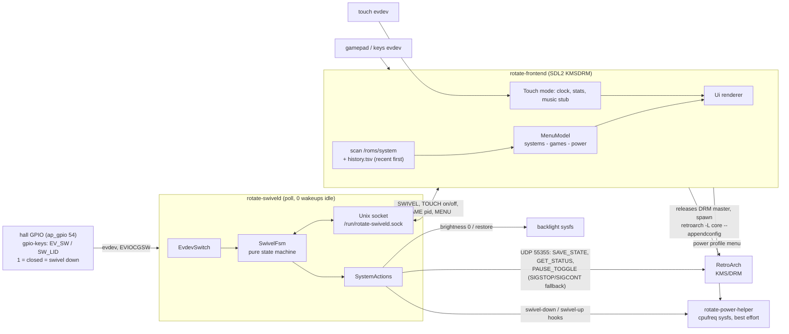

# Rotate OS frontend (Phase 5 scaffold)

Games-first menu for the 720x720 swivel panel, plus `rotate-swiveld`, the daemon that turns the hall switch into
pause / power-save / panel-off / touch mode. Native C++17, SDL2 (KMSDRM on device, no compositor), CMake.
No MIROKI code was copied (it has no license); the design follows the behaviour described in
`../docs/research/02-power-gaming-ux.md` sections 3 and 4 only.

## Architecture



| Piece | Files | Notes |
|---|---|---|
| Swivel state machine | `src/swivel.{h,cpp}` | Pure logic, no I/O. Down+game: `save-state, pause-game, panel-off, power-save`. Up: `power-restore, panel-on, resume-game`. Down+menu: touch mode. |
| evdev source | `src/swivel.cpp` (`EvdevSwitch`) | Works on any fd that carries `input_event` frames: real `/dev/input/eventN`, uinput, or a pipe. Code (`lid` = SW_LID, `tablet` = SW_TABLET_MODE) and closed polarity (`closed_value`) are config. Initial state from `EVIOCGSW`. |
| Daemon | `src/swiveld.{h,cpp}`, `src/swiveld_main.cpp` | Line protocol over AF_UNIX stream (documented in `swiveld.h`). A frontend that dies mid-game counts as "menu" so the panel is never left dark. |
| Pause | `src/retroarch.{h,cpp}` (`RetroArchCtl`) | Asks `GET_STATUS` first so `PAUSE_TOGGLE` is idempotent; no reply -> `SIGSTOP`/`SIGCONT` on the pid the frontend registered; no reply and no pid -> blind toggle. |
| Panel | `src/sysinfo.{h,cpp}` (`Backlight`) | `class/backlight/*/brightness` under the configurable sysfs root. DRM DPMS is **not** implemented (see Open items). |
| Power profiles | `scripts/rotate-power-helper`, `scripts/swivel-{down,up}`, `src/power.cpp` | save = `powersave` + 50 % max cap, balanced = `schedutil`/`ondemand` + 85 %, max = `performance` + 100 %. Writes `scaling_governor` and `scaling_max_freq`, every write best-effort (fixed-frequency boards and read-only files are reported as `skip`, exit 0). Sysfs root = `ROTATE_SYSFS_ROOT` / `[paths] sysfs_root`. |
| Launch / resume | `src/retroarch.cpp`, `config/frontend.ini` | `retroarch -L <core> --appendconfig <state>/retroarch-rotate.cfg [--config base] <rom>`; the append config sets `network_cmd_enable`, `network_cmd_port`, `savestate_auto_save`, `savestate_auto_load`. Auto-load on the next launch of the same content is the resume. |
| Menu | `src/model.{h,cpp}`, `src/ui.{h,cpp}`, `src/main.cpp` | Systems (Recently Played first) -> games -> launch; Y/Start = power profile screen. D-pad, A/B/Y/shoulders via SDL GameController; arrows/Enter/Esc/Tab as keyboard fallback. |
| Touch mode | `src/touch.{h,cpp}`, `src/ui.cpp` | Clock, battery %, CPU freq, hottest thermal zone, governor, music-player stub (state only, no audio). Drawn rotated by `touch_rotation` (default 90, direction UNVERIFIED on the device) and touch coordinates are un-rotated to match. |

Idle behaviour: the daemon blocks in `poll()` with no timeout. The frontend never redraws unless an event arrived or,
in touch mode, the clock/stats tick (<= every 5 s, aligned to the minute). SDL's own `SDL_WaitEvent` degrades to a 1 ms
`SDL_Delay` poll on the dummy and KMSDRM drivers, so the loop polls every 20 ms instead (see `wait_event` in
`src/main.cpp`); while a game runs the frontend is blocked in `waitpid` and has released the DRM master.

Fonts: DejaVu Sans and DejaVu Sans Bold in `assets/fonts/`, Bitstream Vera / DejaVu license (free to use, copy and
redistribute; the fonts must not be sold on their own and renamed derivatives must not use the "Bitstream Vera" name).
Full text: `assets/fonts/LICENSE-DejaVu.txt`.

Palette: one set of colours in `src/theme.h` (text 15.7:1, dim text 8.4:1 (7.3:1 on the panel tiles), dark-on-amber selection 10.1:1 against
the background; selection also carries a `>` marker and the active power profile carries an "ACTIVE" label, so colour is
never the only signal).

## Build and test (x86_64 host)

Needs `cmake`, `g++`, `libsdl2-dev`, `libsdl2-ttf-dev`, `zlib1g-dev` (Ubuntu: `sudo apt install cmake g++ libsdl2-dev libsdl2-ttf-dev zlib1g-dev`).

```sh
cd frontend
cmake -S . -B build && cmake --build build -j
ctest --test-dir build --output-on-failure
```

Individual tests: `build/test_core`, `build/test_swivel`, `build/test_launch`, `build/test_power`; screenshots with
`SDL_VIDEODRIVER=dummy build/rotate-shots --out artifacts`. The `uinput_e2e` test needs root for `/dev/uinput` and
`/dev/input/event*`; `tests/run_uinput.sh` uses passwordless `sudo -n` and reports SKIP (ctest code 77) when that is not
available. Tests only touch temp dirs (`$TMPDIR`) and never the real `/sys`.

On the device (not done here, no hardware attached):

```sh
SDL_VIDEODRIVER=kmsdrm rotate-frontend --config /etc/rotate/frontend.ini     # as root or in video/input/render groups
rotate-swiveld --config /etc/rotate/frontend.ini                              # starts before the frontend
```

## Cross-compile for aarch64

```sh
sudo apt install g++-aarch64-linux-gnu
python3 -I scripts/fetch-aarch64-sysroot.py ~/arm64-sysroot     # downloads arm64 SDL2/SDL2_ttf/zlib debs, dpkg -x only
cmake -S . -B build-arm64 -DCMAKE_TOOLCHAIN_FILE=cmake/aarch64-toolchain.cmake \
      -DROTATE_AARCH64_SYSROOT=$HOME/arm64-sysroot -DROTATE_BUILD_TESTS=OFF
cmake --build build-arm64 -j
```

The toolchain file is `cmake/aarch64-toolchain.cmake` (`-mcpu=cortex-a75.cortex-a55`, as in the research doc's
RetroArch flags). Any aarch64 sysroot with SDL2 + SDL2_ttf works instead (for example the Arch Linux ARM rootfs from the
Phase 2 image build).

## Real test results (this host: Ubuntu 26.04 x86_64, SDL 2.32.10, 2026-10-31)

`ctest --test-dir build`: **7/7 passed**.

| Test | Result | What it exercises |
|---|---|---|
| `core` | 115 checks, 0 failed | INI/config (incl. shipped `config/frontend.ini`), ROM scan over a temp `/roms` tree, title cleaning, history order/dedupe/cap, menu navigation (recent first, scroll window, wrap, power menu, touch overlay restore), touch un-rotation for 0/90/180/270 and hit boxes, battery/CPU/thermal reads and backlight off/on on a fake sysfs |
| `swivel` | 93 checks, 0 failed | FSM transitions incl. edge cases (game starts or dies while swivel is down, duplicate edges); evdev decoding from an injected event stream (pipe: unrelated events, split frames, EOF, flipped polarity, SW_TABLET_MODE); daemon socket protocol; `RetroArchCtl` against a fake UDP endpoint (PLAYING, already PAUSED, no reply -> real `SIGSTOP`/`SIGCONT` on a child process observed via `/proc/<pid>/stat`); `SystemActions` end to end (fake backlight 150 -> 0 -> 150, hook log `down`,`up`, UDP sequence `SAVE_STATE, GET_STATUS, PAUSE_TOGGLE, PAUSE_TOGGLE`); threaded `SwivelClient` including daemon-absent retry |
| `launch` | 15 checks, 0 failed | exact RetroArch argv, append config contents with/without resume-on-wake, spawn/wait with a fake `retroarch` (argv recorded, exit code 7), missing binary -> 127 |
| `power` | 34 checks, 0 failed | `rotate-power-helper` against fake sysfs trees: two-cluster board with OPP list (save 1.0 GHz / balanced 1.5 GHz / max 2.0 GHz from a 2.0 GHz part), fixed-frequency board (skip reported, state still recorded), missing governor, no cpufreq at all, read-only file, bad arguments (exit 2); hooks remember and restore the previous profile |
| `uinput_e2e` | 28 checks, 0 failed (ran under `sudo -n`, not skipped) | A **real evdev device** created through `/dev/uinput` (EV_SW/SW_LID, node `/dev/input/event17` on this run): `EVIOCGSW` initial and live state, polarity flip; then the real `rotate-swiveld` binary driven by that device: `SWIVEL open`, touch mode on/off over the socket, swivel down with a game registered -> backlight 0, hook `down`, `SAVE_STATE, GET_STATUS, PAUSE_TOGGLE` on UDP, swivel up -> backlight restored, hook `up`, second `PAUSE_TOGGLE`, SIGTERM exit 0 and socket removed |
| `screenshots` | 6 PNGs written | `rotate-shots` with SDL's software renderer on the `dummy` driver; each render checked non-blank |
| `idle_cpu` | PASS | `rotate-frontend` on the dummy driver, 2 s idle window: 0 to 1 clock ticks (10 ticks = startup, font load, first draw); the test allows <= 2 |

Screenshots (720x720, inspected by eye; text fits, selection and active states are visible without colour):
`artifacts/01-systems.png`, `02-games-scrolled.png` (PlayStation, 6 / 10), `03-power-profile.png`,
`04-touch-rot90.png` (touch mode turned 90 degrees clockwise), `05-touch-rot0.png`, `06-empty-library.png`.
They use demo data from `src/shots.cpp`, not real ROMs.

aarch64: cross-compiled with `aarch64-linux-gnu-g++` 15 against arm64 SDL2 2.32.10 / SDL2_ttf headers and libs
(`file`: ELF 64-bit LSB pie executable, ARM aarch64) for `rotate-frontend`, `rotate-swiveld`, `rotate-shots`. Under
`qemu-aarch64` the aarch64 `rotate-shots` rendered all six screens and the PNGs are **byte-identical** to the
x86_64 ones; `rotate-swiveld --bogus` printed its usage and exited 2. The unit tests are not built for
aarch64 (the `ROTATE_BUILD_TESTS` option is skipped when cross-compiling).

## Not verified (needs the device, or unknown)

- Nothing here ran on the Rotate. KMSDRM is compiled into this host's SDL (`x11 wayland KMSDRM offscreen dummy evdev`),
  but this host has a desktop session, so the KMSDRM path (fullscreen 720x720 mode set, DRM master hand-off to
  RetroArch and back) was never executed.
- Polarity: `SW_LID` 1 = closed is from the thwonp DT per the research doc; beebono's bring-up doc says
  `SW_TABLET_MODE`. Run `evtest` on the device and set `[swivel] code` / `closed_value` (research Q5).
- Touch-mode rotation direction on the panel, and that SDL KMSDRM delivers `SDL_FINGERDOWN` from the GT911 with
  raw panel axes: both UNVERIFIED (research section 1 notes the GT911 reports raw axes).
- Controller button mapping (A/B swap on Nintendo-style pads) depends on the SDL GameController mapping for the
  gpio-keys gamepad; not checked.
- `GET_STATUS` over UDP needs a RetroArch new enough to answer it; the Arch package (`retroarch 1.22.2-5` per the
  research doc) should, but it was not run. Without it the SIGSTOP fallback applies.
- libretro core file names in `config/frontend.ini` are guesses from Arch package names.
- Savestate auto-load restores the state when the same content is launched again. Whether a state written at
  swivel-down is still valid after a full device sleep/wake cycle is a device test.
- Whether the T618 exposes DVFS at all (research says frequency may be fixed); the helper copes either way.

## Open items

- DRM DPMS blanking (the brief allowed DPMS or backlight): only backlight is implemented; on a panel whose
  backlight is a separate PWM, the DSI panel itself stays powered.
- With the frontend not running (or crashed), swivel-down in the menu has nobody to show touch mode; the daemon
  only broadcasts. A supervisor (init respawn, as MIROKI does for its frontend) is Phase 2/4 work.
- No audio backend for the music stub; no Wi-Fi/brightness controls in touch mode.
- Hold-to-repeat on D-pad buttons (SDL controller events do not auto-repeat).
- The 20 ms input poll is the cost of SDL not offering a blocking wait on these drivers. A blocking epoll on the
  evdev fds directly would remove it.
